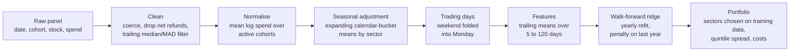
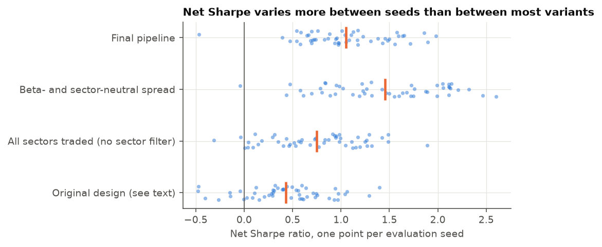
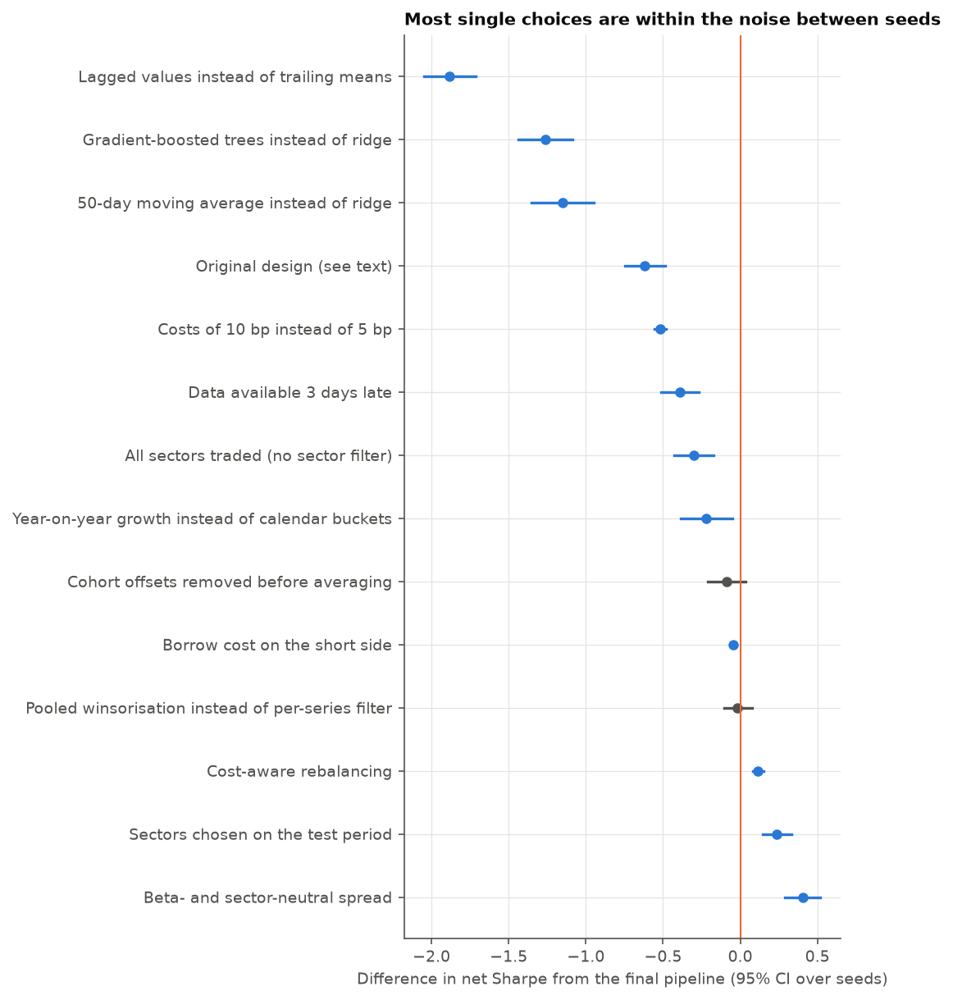
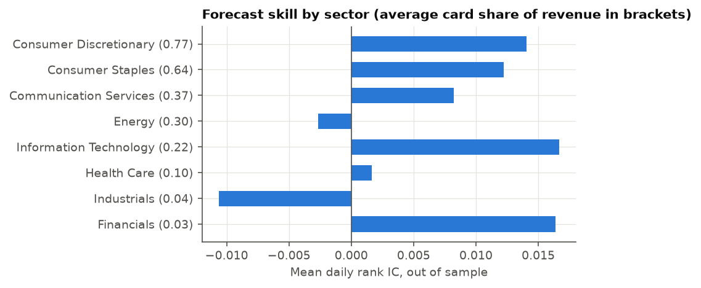
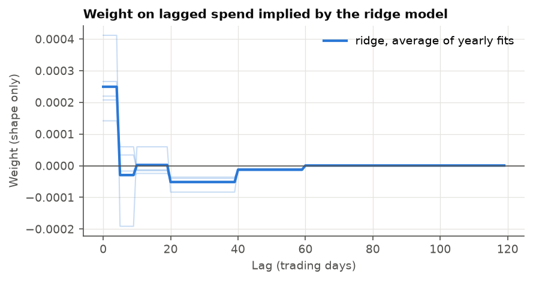
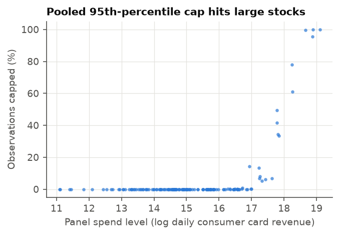
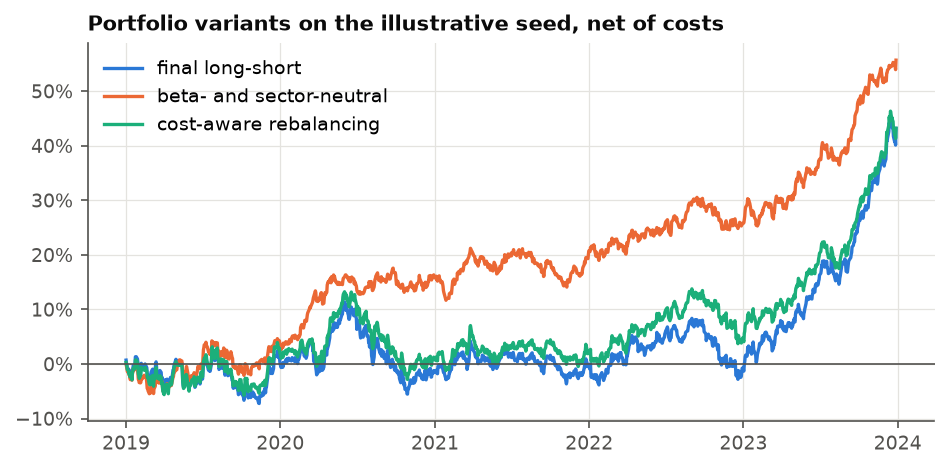
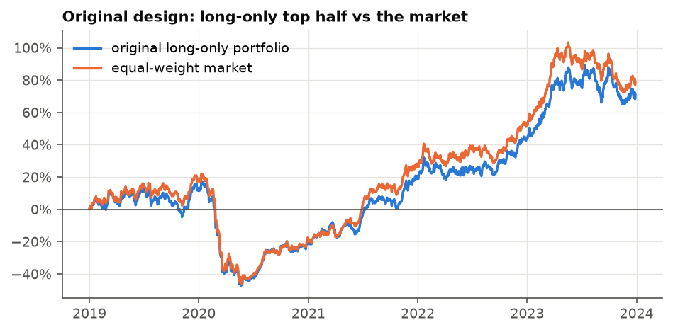
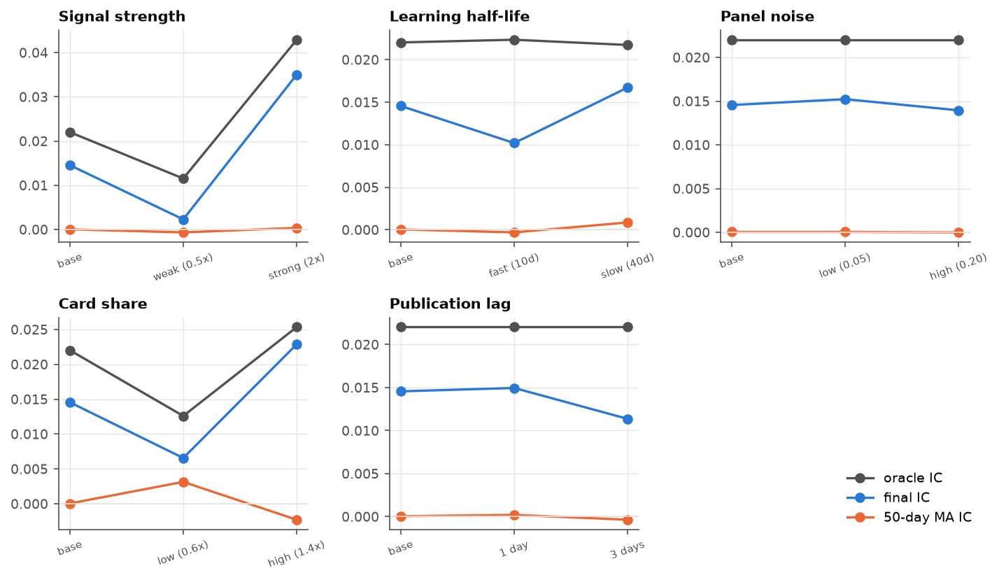

# Forecasting stock returns from credit card spending

[](https://github.com/duemig/consumer-spend-signal/actions/workflows/ci.yml)

A research pipeline that turns a daily panel of credit card transactions into a cross-sectional forecast of next-day stock returns, and a simulation study that measures which processing choices matter.

**All data in this repository is simulated.** Nothing here is real card data. The performance figures describe how the pipeline behaves on a known data-generating process, not a tradable result.

Research note: [docs/report.pdf](docs/report.pdf)

## Background

A credit card panel records what a sample of card holders spends, day by day, at the stores and websites of listed companies. Spending is visible weeks before revenue is reported, which makes card panels a widely used alternative data source in systematic equity research. They are also hard to use well:

- **The panel only sees consumer card revenue.** That is most of a retailer's or restaurant chain's revenue, and almost none of a bank's or an industrial supplier's.
- **Panel composition changes.** Card holders are grouped into cohorts that join and leave the panel, so total spend moves with the number of active cohorts rather than with sales.
- **Strong seasonality.** Spending peaks at weekends and in the holiday season, with different patterns for retail, groceries and fuel.
- **Dirty records.** Raw files contain refunds that exceed purchases, recording errors and corrupt entries.

## Provenance

The pipeline started as a take-home research exercise for Man Group in February 2024. The firm supplied a simulated credit card dataset, which cannot be shared. This repository rebuilds the work on new simulated data:

- **New data.** A simulator written for this repository ([simulate.py](src/spendsignal/simulate.py)) replaces the original dataset.
- **Original methods kept as options.** Every choice from the first version can still be switched on and measured: pooled winsorisation, cohort averaging, calendar-bucket seasonal adjustment, a moving-average signal, ridge regression on lagged values, sector selection on the test period and a long-only portfolio.
- **Added during the rebuild:**
  - a per-series outlier filter
  - trailing-mean features
  - yearly walk-forward refits with the ridge penalty chosen on held-out data
  - sector selection from training data only
  - a dollar-neutral backtest with trading costs
  - point-in-time tests, unit tests and CI
  - the simulation study itself

None of the numbers below come from the original dataset.

## Simulated credit card data

| Item | Value |
|---|---|
| Companies | 150 in 8 GICS sectors |
| Card holder cohorts | 12, joining and leaving at different dates (at least 3 active on any day) |
| Period | 1 January 2016 to 31 December 2023: daily spend, business-day returns |
| Rows | about 3.5 million (date, cohort, stock, spend in dollars) |

**What the panel sees.** Each company has a card share $e_i$, the part of its revenue paid by consumers with cards. It averages about 0.7 in consumer discretionary and 0.6 in consumer staples, and 0.03 in financials. A company's revenue news has a consumer part, which the panel sees, and another part, which it does not:

$$x_{i,t} = e_i \, x^{c}_{i,t} + (1 - e_i)\, x^{o}_{i,t}.$$

**Panel spend.** Daily spend of cohort $k$ at company $i$ is consumer card revenue times the cohort's share of all card holders:

$$\log \text{spend}_{i,k,t} = R_i + \log e_i + g_i \tau_t + \text{season}_{s(i)}(t) + \text{covid}_{s(i)}(t) + x^{c}_{i,t} + c_k + \varepsilon_{i,k,t}.$$

- **Seasonality differs by sector.** Retail and restaurants peak on Fridays, Saturdays and between Black Friday and Christmas, groceries on Saturdays. Fuel is flat. Industrial and health care spending falls at weekends.
- **COVID-19.** From mid-March 2020, discretionary and fuel spending collapse by about a third and recover over the following year. Grocery spending spikes with stockpiling.
- **Noise depends on transaction counts.** The noise of a daily total falls with the number of transactions behind it (average ticket $45), so small merchants and small cohorts are noisy. Net spend turns negative when refunds exceed purchases, which mostly happens when there are few transactions.
- **Recording errors and gaps.** Files contain decimal shifts (x10), duplicated batches (x2) and corrupt entries (`n/a`, `#VALUE!`, `ERR`), and rows for inactive cohorts are absent.

**Returns.** Investors learn about revenue gradually. Their expectation $m_{i,t}$ is an exponentially weighted average of $x_{i,t}$ with a 20-day half-life, and the unpriced part drives the next-day expected return:

$$r_{i,t\to t+1} = \beta_i f_{t+1} + h_{s(i),t+1} + \kappa\, z\!\left(x_{i,t} - m_{i,t}\right) + u_{i,t+1}.$$

The market factor includes the February-March 2020 crash and the recovery that followed. Because the panel sees only consumer revenue news, a forecast that knew the consumer part of $x - m$ exactly (the "card oracle") has a mean daily rank IC of about 0.02. That is the ceiling for any card-based forecast. Knowing all revenue news would give about 0.04.

## Pipeline



1. **Cleaning.** Non-numeric values become missing. Non-positive values (net refunds) cannot be logged and are dropped. Each (stock, cohort) series is compared with the median and median absolute deviation of its own previous 90 days, and values more than 6 robust standard deviations away are removed.
2. **Cohort normalisation.** Average log spend over the cohorts active that day.
3. **Seasonal adjustment.** Subtract expanding sector means, first separately for weekdays and weekends, then for November-December and the rest of the year. This needs about 22 months of burn-in.
4. **Trading days.** Saturday and Sunday are averaged into Monday, which is known at Monday's close.
5. **Forecast.** Ridge regression of the next-day return (cross-sectionally demeaned) on cross-sectionally standardised trailing means of the predictor over 5, 10, 20, 40, 60 and 120 days. It is refitted every January on all earlier data, leaving out the last training day, whose return is only known in the new year. The penalty is chosen by fitting on all but the last training year and maximising the rank IC in that year.
6. **Portfolio.** Trade only sectors whose in-sample IC in the training data has a t-statistic above 2. Each day, go long the top quintile and short the bottom quintile, equally weighted and dollar neutral. Trading costs are 5 bp per unit of one-way turnover.

Every step is point-in-time. [tests/test_no_lookahead.py](tests/test_no_lookahead.py) checks that cutting off the data at a date leaves every earlier predictor value and forecast unchanged.

## Study design

- **Development and evaluation are separate.** Design choices were made on development simulations (seeds 7 to 11). The configuration was then frozen and run once on 50 evaluation simulations (seeds 3001 to 3050), which were not used for any design choice.
- **Out of sample:** 2019 to 2023, about 1,300 trading days per seed, including the 2020 crash.
- **Forecast skill:** daily Spearman rank correlation between forecast and next-day return across stocks (rank IC), with a Newey-West t-statistic (10 lags).
- **Comparing variants:** each variant changes one choice relative to the final pipeline. Differences are reported as the mean paired difference in net Sharpe across the 50 seeds, with a 95% bootstrap confidence interval, so "within noise" is a measured statement rather than a guess.

## Results

Across the 50 evaluation seeds the card oracle has a mean rank IC of 0.0218, the ceiling for a card-based forecast. The final pipeline reaches a mean IC of 0.0156, recovering 72% of the oracle on average, with a range of 29% to 110% across seeds. Its net Sharpe ratio averages 1.05, with a 95% confidence interval of 0.92 to 1.17, but the ratio of a single seed ranges from -0.47 to 1.98 and the IC t-statistic from 1.1 to 6.7. One backtest says little; the distribution is the result.

| Variant | Mean IC | Net Sharpe | 95% CI | Turnover/day |
|---|---|---|---|---|
| **Final pipeline** | **0.0156** | **1.05** | **0.92 to 1.17** | **0.43** |
| Pooled winsorisation instead of per-series filter | 0.0156 | 1.03 | 0.92 to 1.14 | 0.45 |
| Cohort offsets removed before averaging | 0.0149 | 0.96 | 0.84 to 1.08 | 0.42 |
| Year-on-year growth instead of calendar buckets | 0.0121 | 0.83 | 0.70 to 0.96 | 0.32 |
| Lagged values instead of trailing means | 0.0116 | -0.83 | -0.98 to -0.68 | 1.74 |
| 50-day moving average instead of ridge | -0.0004 | -0.10 | -0.25 to 0.04 | 0.01 |
| All sectors traded (no sector filter) | 0.0110 | 0.75 | 0.62 to 0.88 | 0.49 |
| Sectors chosen on the test period | 0.0175 | 1.28 | 1.18 to 1.39 | 0.42 |
| Data available 3 days late | 0.0118 | 0.66 | 0.53 to 0.78 | 0.42 |
| Costs of 10 bp instead of 5 bp | 0.0156 | 0.53 | 0.41 to 0.66 | 0.43 |
| Gradient-boosted trees instead of ridge | 0.0013 | -0.22 | -0.36 to -0.07 | 0.30 |
| Beta- and sector-neutral spread | 0.0156 | 1.45 | 1.28 to 1.62 | 0.37 |
| Cost-aware rebalancing | 0.0156 | 1.17 | 1.04 to 1.29 | 0.29 |
| Borrow cost on the short side | 0.0156 | 1.00 | 0.87 to 1.13 | 0.43 |
| Original design, long-only (see below) | 0.0153 | 0.43 | 0.31 to 0.55 | 0.57 |

The spread of net Sharpe between seeds is wider than the gap between most variants.



Measured against the final pipeline on the same seeds, pooled winsorisation and removing cohort offsets cannot be told apart from it: the 95% interval for the paired difference in net Sharpe includes zero. Year-on-year adjustment, within noise on fewer seeds, is a small but consistent loss over 50 (a net-Sharpe difference of -0.22, 95% CI -0.39 to -0.05). Single lags, the plain moving average and the gradient-boosted tree lose to the final pipeline by a wide margin, and trading every sector lowers the net Sharpe as well.



The full output, including per-sector statistics, the paired differences and the simulator sweeps, is in [results/](results).

## Findings

1. **Recovery.** Across 50 seeds the pipeline reaches a mean IC of 0.0156 against the oracle's 0.0218, recovering 72% on average, with IC t-statistics between 1.1 and 6.7.
2. **Skill sits where card revenue is.** Out-of-sample IC is highest in consumer discretionary and consumer staples. Where the card share is small it is close to zero or negative. Restricting the portfolio to sectors that passed a t-test in the training data raised the IC and the net Sharpe. Choosing sectors by test-period performance does slightly better, but it uses the future and only serves as a benchmark.

   

3. **The ridge learns the right shape, and flexibility does not help.** Weights are positive on the last one to two weeks and negative on two to twelve weeks back, the "new information minus what is already priced" shape implied by gradual learning. A gradient-boosted tree on the same six features, chosen and refitted the same way, reaches a mean IC of only 0.0013, well below the ridge's 0.0156. The simulated signal is linear in the predictor, so the extra flexibility finds nothing.

   

4. **Feature design decides the net result.** Single lagged values give a similar IC (0.0116) but turn the book over 1.7 times a day and lose money after costs (net Sharpe -0.83). Trailing means give the same model a smoother input, cut turnover to 0.43 and lift the net Sharpe to 1.05.
5. **A plain moving average has no skill here.** A 50-day average mostly measures what investors already know, and its IC is indistinguishable from zero (-0.0004). That follows from the simulated learning process; real data could behave differently.
6. **Pooled winsorisation caps large companies, not outliers.** Clipping each day at the 95th percentile of all stocks and cohorts caps more than half of all observations for a handful of the largest merchants in the panel.

   

7. **Some processing choices are within noise.** Pooled winsorisation and removing cohort offsets each move the net Sharpe by less than the variation between seeds: the 95% confidence interval for the paired difference from the final pipeline includes zero. The choice between calendar-bucket and year-on-year adjustment is the borderline case. It is within noise on a handful of seeds but a small, consistent loss across 50 (-0.22 in net Sharpe). A single backtest cannot separate the first two.
8. **Costs and borrow matter.** At 10 bp per unit of turnover the mean net Sharpe halves to 0.53. A borrow fee of 50 bp a year on the short side lowers it only to 1.00.
9. **A neutral book and cost-aware trading improve the net result.** A beta- and sector-neutral book, which trades the forecast after projecting out estimated market beta and the sector dummies, raises the mean net Sharpe to 1.45 and cuts turnover to 0.37 and the drawdown sharply. Moving part of the way towards the target weights each day, rather than trading fully, cuts turnover to 0.29 and lifts the net Sharpe to 1.17.

   

10. **The long-only design rode the market.** The original design (untuned ridge on lags, sectors picked on the test period, long-only top half) earned a mean net Sharpe of 0.43 with large drawdowns in the 2020 crash. Its return is mostly market exposure.

    

11. **How far the conclusions depend on the simulator.** Varying the five main simulator parameters one at a time changes the level of skill but not the ranking of the methods. Recovery rises when the card share or the signal is stronger and falls when the data arrives late or the panel is noisier, while the moving average stays near zero and the sector filter keeps helping throughout.

    

## Limitations

- **The simulator shapes the level of skill.** The sweeps above show which conclusions survive a change in the data-generating process and which do not. What they cannot show is behaviour on real card data: the study measures recovery of a known signal, not a tradable edge.
- **Portfolio and cost model.** The book now has a beta- and sector-neutral version, a cost-aware rebalancing rule and a short borrow cost. Still absent: capacity limits, market impact, a full risk model, and financing beyond a flat borrow fee.
- **Statistics.** Fifty evaluation seeds with a 95% bootstrap confidence interval on each paired difference. Still one test period per seed, and one simulated process.

## Reproducing

```bash
pip install -e ".[dev]"
pytest                          # a few seconds
python scripts/run_study.py     # a few minutes; resumable, fills results/ and docs/figures/
```

The study caches one file per evaluation seed under `results/.cache/`, so it can be run a seed at a time (`python scripts/run_study.py --seeds 3001 3002`) and resumed. Rebuilding the research note needs Playwright and Chromium, which are an optional dependency group and are not required for the study or CI:

```bash
pip install -e ".[report]"
playwright install chromium
python scripts/build_report.py  # rebuilds docs/report.pdf from results/
```

## Repository layout

| Path | Contents |
|---|---|
| `src/spendsignal/simulate.py` | Credit card panel and return simulator |
| `src/spendsignal/panel.py` | Cleaning, outlier filters, cohort normalisation |
| `src/spendsignal/seasonality.py` | Calendar-bucket and year-on-year adjustment, trading-day alignment |
| `src/spendsignal/forecast.py` | Trailing-mean and lag features, walk-forward ridge and tree, sector selection |
| `src/spendsignal/evaluation.py` | Rank IC, Newey-West t-statistic, per-sector statistics, bootstrap intervals |
| `src/spendsignal/backtest.py` | Long-short, long-only and beta- and sector-neutral portfolios, rebalancing, costs |
| `src/spendsignal/pipeline.py` | Configurable end-to-end pipeline and the original-design preset |
| `src/spendsignal/study.py` | Variant grid, per-seed evaluation, aggregation and the simulator sweeps |
| `scripts/run_study.py` | Runs the study and writes all results and figures |
| `scripts/build_report.py` | Builds the research note from `results/` |
| `tests/` | Unit tests, point-in-time tests and the README-against-results check |
| `docs/report.pdf` | Research note |
