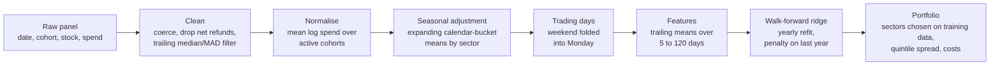

# Forecasting stock returns from credit card spending

[](https://github.com/duemig/consumer-spend-signal/actions/workflows/ci.yml)

A research pipeline that turns a daily panel of credit card transactions into a cross-sectional forecast of next-day stock returns, and a simulation study that measures which processing choices matter.

**All data in this repository is simulated.** Nothing here is real card data. The performance figures describe how the pipeline behaves on a known data-generating process, not a tradable result.

Research note: [docs/report.pdf](docs/report.pdf)

## Background

A credit card panel records what a sample of card holders spends, day by day, at the stores and websites of listed companies. Spending is visible weeks before revenue is reported, which makes card panels a widely used alternative data source in systematic equity research. They are also hard to use well:

- **The panel only sees consumer card revenue.** That is most of a retailer's or restaurant chain's revenue, and almost none of a bank's or an industrial supplier's.
- **Panel composition changes.** Card holders are grouped into cohorts that join and leave the panel, so total spend moves with the number of active cohorts rather than with sales.
- **Strong seasonality.** Spending peaks at weekends and in the holiday season, with different patterns for retail, groceries and fuel.
- **Dirty records.** Raw files contain refunds that exceed purchases, recording errors and corrupt entries.

## Provenance

The pipeline started as a take-home research exercise for Man Group in February 2024. The firm supplied a simulated credit card dataset, which cannot be shared. This repository rebuilds the work on new simulated data:

- **New data.** A simulator written for this repository ([simulate.py](src/spendsignal/simulate.py)) replaces the original dataset.
- **Original methods kept as options.** Every choice from the first version can still be switched on and measured: pooled winsorisation, cohort averaging, calendar-bucket seasonal adjustment, a moving-average signal, ridge regression on lagged values, sector selection on the test period and a long-only portfolio.
- **Added during the rebuild:**
  - a per-series outlier filter
  - trailing-mean features
  - yearly walk-forward refits with the ridge penalty chosen on held-out data
  - sector selection from training data only
  - a dollar-neutral backtest with trading costs
  - point-in-time tests, unit tests and CI
  - the simulation study itself

None of the numbers below come from the original dataset.

## Simulated credit card data

| Item | Value |
|---|---|
| Companies | 150 in 8 GICS sectors |
| Card holder cohorts | 12, joining and leaving at different dates (at least 3 active on any day) |
| Period | 1 January 2016 to 31 December 2023: daily spend, business-day returns |
| Rows | about 3.7 million (date, cohort, stock, spend in dollars) |

**What the panel sees.** Each company has a card share $e_i$, the part of its revenue paid by consumers with cards. It averages about 0.7 in consumer discretionary and 0.6 in consumer staples, and 0.03 in financials. A company's revenue news has a consumer part, which the panel sees, and another part, which it does not:

$$x_{i,t} = e_i \, x^{c}_{i,t} + (1 - e_i)\, x^{o}_{i,t}.$$

**Panel spend.** Daily spend of cohort $k$ at company $i$ is consumer card revenue times the cohort's share of all card holders:

$$\log \text{spend}_{i,k,t} = R_i + \log e_i + g_i \tau_t + \text{season}_{s(i)}(t) + \text{covid}_{s(i)}(t) + x^{c}_{i,t} + c_k + \varepsilon_{i,k,t}.$$

- **Seasonality differs by sector.** Retail and restaurants peak on Fridays, Saturdays and between Black Friday and Christmas, groceries on Saturdays. Fuel is flat. Industrial and health care spending falls at weekends.
- **COVID-19.** From mid-March 2020, discretionary and fuel spending collapse by about a third and recover over the following year. Grocery spending spikes with stockpiling.
- **Noise depends on transaction counts.** The noise of a daily total falls with the number of transactions behind it (average ticket $45), so small merchants and small cohorts are noisy. Net spend turns negative when refunds exceed purchases, which mostly happens when there are few transactions.
- **Recording errors and gaps.** Files contain decimal shifts (x10), duplicated batches (x2) and corrupt entries (`n/a`, `#VALUE!`, `ERR`), and rows for inactive cohorts are absent.

**Returns.** Investors learn about revenue gradually. Their expectation $m_{i,t}$ is an exponentially weighted average of $x_{i,t}$ with a 20-day half-life, and the unpriced part drives the next-day expected return:

$$r_{i,t\to t+1} = \beta_i f_{t+1} + h_{s(i),t+1} + \kappa\, z\!\left(x_{i,t} - m_{i,t}\right) + u_{i,t+1}.$$

The market factor includes the February-March 2020 crash and the recovery that followed. Because the panel sees only consumer revenue news, a forecast that knew the consumer part of $x - m$ exactly (the "card oracle") has a mean daily rank IC of about 0.02. That is the ceiling for any card-based forecast. Knowing all revenue news would give about 0.04.

## Pipeline



1. **Cleaning.** Non-numeric values become missing. Non-positive values (net refunds) cannot be logged and are dropped. Each (stock, cohort) series is compared with the median and median absolute deviation of its own previous 90 days, and values more than 6 robust standard deviations away are removed.
2. **Cohort normalisation.** Average log spend over the cohorts active that day.
3. **Seasonal adjustment.** Subtract expanding sector means, first separately for weekdays and weekends, then for November-December and the rest of the year. This needs about 22 months of burn-in.
4. **Trading days.** Saturday and Sunday are averaged into Monday, which is known at Monday's close.
5. **Forecast.** Ridge regression of the next-day return (cross-sectionally demeaned) on cross-sectionally standardised trailing means of the predictor over 5, 10, 20, 40, 60 and 120 days. It is refitted every January on all earlier data, leaving out the last training day, whose return is only known in the new year. The penalty is chosen by fitting on all but the last training year and maximising the rank IC in that year.
6. **Portfolio.** Trade only sectors whose in-sample IC in the training data has a t-statistic above 2. Each day, go long the top quintile and short the bottom quintile, equally weighted and dollar neutral. Trading costs are 5 bp per unit of one-way turnover.

Every step is point-in-time. [tests/test_no_lookahead.py](tests/test_no_lookahead.py) checks that cutting off the data at a date leaves every earlier predictor value and forecast unchanged.

## Study design

- **Development and evaluation are separate.** Design choices were made on a development simulation (seed 7). The final configuration was then frozen and run on an evaluation simulation (seed 2024), plus four further seeds for robustness.
- **Out of sample:** 2019 to 2023, 1,303 trading days, including the 2020 crash.
- **Forecast skill:** daily Spearman rank correlation between forecast and next-day return across stocks (rank IC), with a Newey-West t-statistic (10 lags).
- **Ablations:** each row below changes one choice relative to the final pipeline.

## Results

Evaluation seed 2024. Card oracle IC 0.0203.

| Variant | Mean IC | t (NW) | Sharpe gross | Sharpe net | Return net | Vol | Max DD | Turnover/day |
|---|---|---|---|---|---|---|---|---|
| **Final pipeline** | **0.0132** | **3.2** | **1.35** | **0.90** | **9.4%** | **10.4%** | **16.4%** | **0.37** |
| Pooled winsorisation instead of per-series filter | 0.0122 | 3.2 | 1.10 | 0.63 | 6.4% | 10.3% | 15.6% | 0.38 |
| Cohort offsets removed before averaging | 0.0153 | 3.9 | 1.61 | 1.13 | 12.0% | 10.6% | 15.2% | 0.40 |
| Year-on-year growth instead of calendar buckets | 0.0150 | 4.0 | 1.44 | 1.11 | 11.7% | 10.6% | 13.3% | 0.28 |
| Lagged values instead of trailing means | 0.0125 | 3.3 | 1.07 | -0.65 | -7.2% | 11.2% | 46.7% | 1.52 |
| 50-day moving average instead of ridge | 0.0031 | 0.7 | 1.09 | 1.08 | 12.2% | 11.3% | 22.1% | 0.01 |
| All sectors traded (no sector filter) | 0.0112 | 3.8 | 1.72 | 1.05 | 8.3% | 7.9% | 9.5% | 0.41 |
| Sectors chosen on the test period | 0.0132 | 3.2 | 1.35 | 0.90 | 9.4% | 10.4% | 16.4% | 0.37 |
| Data available 3 days late | 0.0115 | 3.3 | 1.56 | 1.13 | 10.5% | 9.3% | 14.7% | 0.32 |
| Costs of 10 bp instead of 5 bp | 0.0132 | 3.2 | 1.35 | 0.45 | 4.7% | 10.4% | 18.8% | 0.37 |
| Original design, long-only (see below) | 0.0119 | 3.7 | 0.93 | 0.61 | 13.3% | 21.9% | 57.0% | 0.57 |

Robustness across five evaluation seeds:

| Seed | Card oracle IC | Final IC | t (NW) | Final net Sharpe | No sector filter: IC | net Sharpe |
|---|---|---|---|---|---|---|
| 2024 | 0.0203 | 0.0132 | 3.2 | 0.90 | 0.0112 | 1.05 |
| 2025 | 0.0176 | 0.0110 | 3.2 | 0.31 | 0.0090 | 0.21 |
| 2026 | 0.0217 | 0.0099 | 2.2 | -0.31 | 0.0074 | -0.08 |
| 2027 | 0.0264 | 0.0182 | 4.6 | 1.10 | 0.0105 | 0.35 |
| 2028 | 0.0208 | 0.0205 | 6.0 | 1.76 | 0.0130 | 1.44 |

The full output, including per-sector statistics and ridge coefficients, is in [results/](results).

## Findings

1. **Recovery.** Across seeds, the pipeline reaches 46% to 99% of the card oracle's IC (mean 0.015 against 0.021), with t-statistics between 2.2 and 6.0.
2. **Skill sits where card revenue is.** Out-of-sample IC is highest in consumer discretionary and consumer staples. Where the card share is small it is close to zero or negative. Industrials shows a t-statistic of -2.1 in this seed, which is consistent with chance when eight sectors are tested. Restricting the portfolio to sectors that passed a t-test in the training data raised the IC in all five seeds and the net Sharpe in three. Choosing sectors by test-period performance, as in the first version, picked the same sectors here and added nothing.

   

3. **The ridge learns the right shape.** Weights are positive on the last one to two weeks and negative on two to twelve weeks back. That is a "new information minus what is already priced" filter, the shape implied by gradual learning.

   

4. **Feature design decides the net result.** Regressing on single lagged values gives a similar IC but turns the book over 1.5 times a day, and the strategy loses money after costs. Trailing means give the same model a smoother input and cut turnover by three quarters.
5. **A plain moving average has no skill here.** A 50-day average mostly measures what investors already know, and its IC is indistinguishable from zero. Its positive Sharpe ratio comes from a portfolio that holds the same names for months, not from forecasting. That follows from the simulated learning process; real data could behave differently.
6. **Pooled winsorisation caps large companies, not outliers.** Clipping each day at the 95th percentile of all stocks and cohorts caps more than half of all observations for 7 of the 150 companies, the largest merchants in the panel.

   

7. **Many processing choices are within noise.** Cleaning, cohort normalisation and the choice between calendar-bucket and year-on-year seasonal adjustment move the IC by about 0.002 either way. That is smaller than the variation between seeds, and for pooled winsorisation and year-on-year growth the sign of the difference flips between the development and evaluation simulations. A single backtest cannot rank them.
8. **Costs matter.** At 10 bp per unit of turnover, the net Sharpe ratio halves to 0.45.
9. **The long-only design rode the market.** The original design (untuned ridge on lags, sectors picked on the test period, long-only top half) earned 13.3% a year with a 57% drawdown in the 2020 crash. The equal-weight market earned 15.3% at lower volatility, so its return is market exposure.

   

## Limitations

- **The simulator decides which methods win.** The moving average fails because of how investor learning is modelled. The study shows the pipeline recovering a known signal and how each choice affects that recovery, not how real card data behaves.
- **Simple portfolio and cost model.** Equal weights, no risk model beyond dollar neutrality, linear costs, and no borrow costs, capacity limits or market impact.
- **Statistics.** Five evaluation seeds and one test period per seed. Net Sharpe ratios vary from -0.3 to 1.8 across seeds, so single-seed differences in the table are not reliable.

## Reproducing

```bash
pip install -e ".[dev]"
pytest                       # 28 tests, a few seconds
python scripts/run_study.py  # a few minutes; rewrites results/ and docs/figures/
```

## Repository layout

| Path | Contents |
|---|---|
| `src/spendsignal/simulate.py` | Credit card panel and return simulator |
| `src/spendsignal/panel.py` | Cleaning, outlier filters, cohort normalisation |
| `src/spendsignal/seasonality.py` | Calendar-bucket and year-on-year adjustment, trading-day alignment |
| `src/spendsignal/forecast.py` | Trailing-mean and lag features, walk-forward ridge, sector selection |
| `src/spendsignal/evaluation.py` | Rank IC, Newey-West t-statistic, per-sector statistics |
| `src/spendsignal/backtest.py` | Long-short and long-only portfolios, costs, performance |
| `src/spendsignal/pipeline.py` | Configurable end-to-end pipeline and the original-design preset |
| `scripts/run_study.py` | Runs the study and writes all results and figures |
| `tests/` | Unit tests and point-in-time tests |
| `docs/report.pdf` | Research note |
